# Kit SaaS LATAM

Skills para agentes con lo que nadie te explica cuando lanzas un SaaS en México:
la ley de datos personales de 2025, facturación CFDI, cobros con Stripe y Mercado
Pago sin regalar créditos, RLS en Supabase y seguridad para React, Supabase y Vercel.

Son archivos Markdown. Tu agente los lee cuando el tema aparece y trabaja con estas
reglas en lugar de improvisarlas.

[English below](#english)

## Qué trae

| Skill | Para qué |
|---|---|
| [`legal-mx`](skills/legal-mx/SKILL.md) | Aviso de privacidad con la LFPDPPP de 2025 (sin INAI), términos, cookies con consentimiento real, disclaimer de IA y CFDI 4.0 |
| [`pagos-mx`](skills/pagos-mx/SKILL.md) | Stripe y Mercado Pago: checkout, webhooks con firma, OXXO, reembolsos y acreditación que no se duplica |
| [`supabase-rls`](skills/supabase-rls/SKILL.md) | Llaves nuevas, políticas por tabla, funciones `security definer` sin hoyos, Storage y cómo depurar |
| [`seguridad-saas`](skills/seguridad-saas/SKILL.md) | Rate limit en serverless, créditos de IA sin doble gasto, CSP, CORS, bots y supply chain de npm |

## Los errores que evita

Salen de código real que yo mismo tuve que corregir:

- Una función `security definer` sin `revoke`: cualquiera se regala créditos desde la
  consola del navegador.
- Una política `for all` en la tabla de saldo: el usuario edita su propio saldo.
- Verificar créditos, llamar al modelo y luego descontar: diez requests en paralelo
  con un crédito pasan todas.
- Webhooks sin firma o sin llave única: pagos falsos y créditos dobles.
- Un pago en OXXO que nunca se acredita porque llega días después.
- Un aviso de privacidad que todavía cita al INAI.

El SQL de `pagos-mx` y `supabase-rls` está probado en PostgreSQL 16 con los roles de
Supabase: un webhook repetido no acredita dos veces y un usuario no puede leer, editar
ni reasignar filas ajenas.

## Instalar

**Claude Code** (como plugin):

```bash
git clone https://github.com/SamaelFL/kit-saas-latam.git
cd kit-saas-latam
claude plugin marketplace add "$PWD"
claude plugin install kit-saas-latam@kit-saas-latam
```

**Claude en la web o el escritorio:** comprime la carpeta de la skill que quieras
(por ejemplo `skills/pagos-mx`) y súbela como skill en la configuración de Claude.

**Otros agentes** (Cursor, Codex, etc.): copia el `SKILL.md` que necesites a las
reglas o instrucciones de tu proyecto.

## Aviso

Esto no es asesoría legal ni fiscal. Los templates de `legal-mx` son un punto de
partida: revísalos con un abogado y un contador antes de publicarlos. Las leyes,
las APIs de pago y las llaves de Supabase cambian; si algo ya no cuadra, abre un issue.

## Licencia

MIT

---

## English

Agent skills for shipping a SaaS in Mexico: the 2025 personal data law (LFPDPPP),
CFDI e-invoicing, Stripe and Mercado Pago payments that never double-credit,
Supabase RLS, and security for a React + Supabase + Vercel stack. The skills are
written in Spanish because the audience is Latin American developers; any modern
model reads them fine.

Install in Claude Code:

```bash
git clone https://github.com/SamaelFL/kit-saas-latam.git
cd kit-saas-latam
claude plugin marketplace add "$PWD"
claude plugin install kit-saas-latam@kit-saas-latam
```

Not legal or tax advice. MIT licensed.
